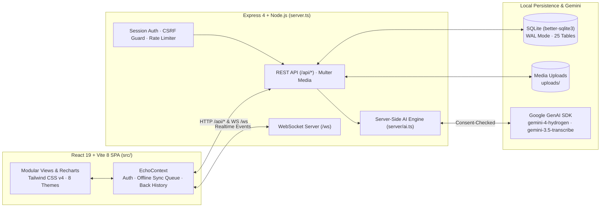

<div align="center">

<br />

# ✦ ECHO — The Human Memory Network

### **Save what matters. Understand your life. Connect with humanity.**

*A private, AI-assisted personal memory archive, daily mindful reflection studio, and human connection network — crafted for web and mobile.*

<br />

[](https://react.dev/)
[](https://www.typescriptlang.org/)
[](https://tailwindcss.com/)
[](https://recharts.org/)
[](https://expressjs.com/)
[](https://www.sqlite.org/)
[](https://ai.google.dev/)
[](https://capacitorjs.com/)

<br />

[Overview](#-overview) · [Daily Check-In & AI](#-daily-check-in--reflection-loop) · [Modules](#-platform-modules) · [Themes](#-visual-themes) · [Architecture](#-architecture) · [Quick Start](#-getting-started) · [Android CI](#-android-apk-pipeline)

</div>

---

## ✨ Overview

**ECHO** unifies quiet personal preservation with meaningful human connection inside one cohesive, local-first application. Every memory, voice recording, dream log, object heirloom, and sealed time capsule lives in your own **SQLite** database — protected by explicit per-entry AI privacy controls, offline mutation queueing, real-time WebSocket updates, and eight curated light, dark, and frosted-glass themes.

> **Privacy First by Design** — `GEMINI_API_KEY` stays strictly on the Express server. Users control global AI access (`aiConsent`) and can exclude individual memories (`aiExcluded`) before any prompt is ever assembled.

---

## 🌅 Daily Check-In & Reflection Loop

ECHO’s **Home Dashboard** centers around a calm, 60-second daily ritual that turns fleeting days into measurable emotional insight:

<table>
  <tr>
    <td width="50%" valign="top">
      <h3>🎙️ Voice-Enabled Daily Check-In</h3>
      <p>
        Answers one mindful prompt each day while tracking your check-in streak and mood.
        Record naturally with the inline <strong>Speak Answer</strong> microphone button — audio uploads securely and transcribes automatically via <code>gemini-3.5-transcribe</code>.
      </p>
    </td>
    <td width="50%" valign="top">
      <h3>📈 Color-Coded 30-Day Sentiment Graph</h3>
      <p>
        Built with <strong>Recharts</strong> to visualize valence across the last 30 days (<code>-100</code> to <code>+100</code>) with threshold-aligned gradient fills, impact-mix breakdown, and distinct <strong>Positive</strong>, <strong>Neutral</strong>, and <strong>Negative</strong> data points.
      </p>
    </td>
  </tr>
  <tr>
    <td width="50%" valign="top">
      <h3>🪞 Gemini Monthly Reflection</h3>
      <p>
        Synthesizes your daily check-in answers into a structured <strong>Monthly Reflection</strong> card — surfacing recurring themes, linked check-in citations, emotional arc, and a gentle closing prompt persisted in SQLite.
      </p>
    </td>
    <td width="50%" valign="top">
      <h3>🕰️ On This Day & Archive Pulse</h3>
      <p>
        Surfaces meaningful flashbacks from past years alongside live archive metrics and one-tap quick capture launchers across memories, capsules, dreams, and objects.
      </p>
    </td>
  </tr>
</table>

---

## 🧩 Platform Modules

| Module | Experience & Key Capabilities |
| :--- | :--- |
| **🏠 Home Dashboard** | Daily mindful check-in, voice-to-text capture, 30-day color-coded sentiment chart, Monthly Reflection card, and *On This Day* flashbacks. |
| **📚 ECHO Memory** | Full life archive with **Timeline**, **Calendar**, **Collections**, privacy-clustered **Memory Map**, **People** directory, **Tag Manager**, **Slideshow**, and JSON export. |
| **✨ AI Life Memory** | Grounded conversational Q&A across your personal archive with clickable source citations (`gemini-4-hydrogen`) plus a **Spoken Memory Studio** with live waveform metering. |
| **⏳ Time Capsules** | Seal letters and media until a chosen future date and timezone; the backend strictly blocks locked capsule media until the unlock timestamp arrives. |
| **🌙 Dream Archive** | Capture dreams with vividness ratings, recurring flags, emotional tone, voice notes, and AI-assisted dream reflections. |
| **🏺 Life Behind Objects** | Document stories and ownership lineage behind meaningful heirlooms with optional public share slugs and generated **QR codes**. |
| **🤝 SkillSwap** | Create teach/learn skill profiles, discover mutual matches, schedule peer exchanges, and message partners directly. |
| **🌍 Wisdom & Humanity** | Share anonymous life lessons (**Stranger's Wisdom**) and global moments (**Humanity Feed**) across approximate world regions with reactions, replies, blocking, and reporting. |
| **🧭 Discover & Profile** | Unified search, theme switcher, global AI consent toggle, storage usage meter, full JSON archive export, and account deletion. |

---

## 🎨 Visual Themes

ECHO ships with **eight semantic theme palettes**, persisted per account and synchronized to the browser with zero flash:

| Theme | Mode | Palette Preview | Aesthetic Character |
| :--- | :---: | :--- | :--- |
| **Social Bloom** *(Default)* | ☀️ Light |    | Crisp creator-feed canvas with coral-rose & electric violet accents |
| **Social Pulse Dark** | 🌙 Dark |    | Luminous coral-magenta & violet highlights on deep indigo night |
| **Midnight Obsidian** | 🌙 Dark |    | Deep obsidian canvas with crisp, high-contrast slate surfaces |
| **Obsidian Glass** | 🧊 Dark Glass |    | Translucent dark frosted panes floating over an ambient aurora |
| **Crystal Glass** | 🧊 Light Glass |    | Bright frosted alabaster glass with refined slate typography |
| **Aurora Borealis** | 🌙 Dark |    | Nordic deep-sea slate with tranquil teal and cyan highlights |
| **Amber Hearth** | 🌙 Dark |    | Warm walnut dark palette tuned for calm evening journaling |
| **Nebula Dusk** | 🌙 Dark |    | Twilight indigo and plum surfaces for dream & reflection logs |

---

## 🏗️ Architecture



<details>
<summary><strong>📂 Project Directory & Backend Route Map</strong></summary>

```text
.
├── server.ts                          # Express + Vite dev/prod entrypoint & HTTP/WS server
├── server/
│   ├── ai.ts                          # Grounded Q&A, sentiment scoring, monthly reflection & transcription
│   ├── auth.ts                        # Session auth, CSRF protection & per-route rate limiting
│   ├── db.ts                          # SQLite WAL schema (25 tables) & automatic startup migrations
│   ├── ws.ts                          # Authenticated WebSocket notifications & real-time events
│   └── routes/
│       ├── authRoutes.ts              # Registration, login, profile, theme & full JSON archive export
│       ├── memoryAndMediaRoutes.ts    # Memories CRUD, tags, sentiment filtering & media uploads
│       ├── capsuleAndAiRoutes.ts      # Time capsules, ECHO AI Q&A, sentiment, transcription & reflections
│       ├── communityAndSkillRoutes.ts # Wisdom, Humanity feed, moderation & SkillSwap exchanges
│       └── objectDreamAndSyncRoutes.ts# Dashboard, Objects, Dreams, Search, Notifications & Offline Sync
├── src/
│   ├── App.tsx                        # Root application shell & active module router
│   ├── index.css                      # Tailwind CSS v4 & multi-theme CSS custom properties
│   ├── context/EchoContext.tsx        # Auth state, theme persistence, offline sync & tab history
│   ├── lib/
│   │   ├── api.ts                     # Authenticated API client & offline cache helpers
│   │   └── themes.ts                  # 8 theme definitions & document switcher
│   ├── types/echo.ts                  # Shared TypeScript domain interfaces
│   └── components/                    # Dashboard, Check-In, Sentiment Chart, Reflection & Module views
├── .github/workflows/build-apk.yml    # Automated Android debug APK build & GitHub Release workflow
├── capacitor.config.ts                # Capacitor container configuration (com.echo.memorynetwork)
├── .env.example                       # Environment variable template
└── package.json                       # Scripts and dependencies
```

</details>

---

## 🚀 Getting Started

### Prerequisites

- **Node.js** `20+` *(tested on Node 22)*
- **npm** *(or Bun via `bun.lock`)*
- A **Gemini API key** for AI Life Memory Q&A, voice-to-text transcription, sentiment scoring, and Monthly Reflections

### 1. Install Dependencies

```bash
npm install
```

### 2. Configure Environment

```bash
cp .env.example .env
```

| Variable | Purpose | Default |
| :--- | :--- | :--- |
| `GEMINI_API_KEY` | Server-side key for `@google/genai` queries, transcription, sentiment & reflections. | *Required for AI* |
| `APP_URL` | Public URL where the app is hosted for self-referential links. | `http://localhost:3000` |
| `PORT` | HTTP and WebSocket server listening port. | `3000` |

### 3. Run & Build

```bash
# Start Express API, WebSocket server, and Vite middleware on port 3000
npm run dev

# Run TypeScript type check
npm run lint

# Build production SPA bundle into dist/
npm run build

# Serve production API + built dist/ bundle
NODE_ENV=production npm start
```

Open **[http://localhost:3000](http://localhost:3000)** to launch ECHO.

---

## 📱 Android APK Pipeline

ECHO is mobile-ready (`com.echo.memorynetwork` via **Capacitor**) and includes an automated **GitHub Actions** pipeline in `.github/workflows/build-apk.yml`:

- **Triggers:** Automatic on every push to `main` plus manual `workflow_dispatch`.
- **Toolchain:** `ubuntu-latest` · **Temurin Java 17+** · **Gradle 9.3.1** · Temporary debug keystore generated strictly inside the runner.
- **Outputs:**
  - Backup GitHub Actions artifact: `app-debug-apk`
  - Versioned GitHub Release (`debug-apk-build-<run_number>-<run_attempt>`) publishing `app-debug.apk` as the `--latest` release asset.

---

## 🛡️ Security & Data Ownership

- **Zero Client AI Exposure:** `GEMINI_API_KEY` never enters the browser bundle; all Gemini calls execute behind authenticated `/api/*` endpoints.
- **Strict Capsule Locks:** Sealed Time Capsule attachments are blocked at `/api/media/:id` until `unlock_at` has passed.
- **Hardened Requests:** Session cookies, `X-Requested-With` CSRF validation, per-route rate limiting, and SQLite foreign keys enabled by default.
- **Portable Data:** Export your entire personal archive as JSON anytime directly from **Profile & Settings**.

---

<div align="center">

Built with care for human memories, quiet reflection, and shared stories.

</div>
